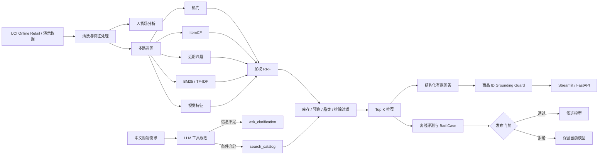

# ShopMind AI 系统架构

## 设计原则

- **召回与排序解耦**：各路召回保留来源和排名证据，RRF 负责融合，实验排序器不能绕过离线门禁。
- **训练与测试隔离**：权重选择使用前 100 名用户，正式结果使用后 200 名独立用户。
- **可解释但不虚构**：导购理由只能引用商品字段、约束和召回证据。
- **模型不直接访问数据库**：LLM 只能通过声明的检索工具获得候选，最终商品 ID 必须通过工具结果白名单。
- **错误可降级**：模型超时、API 错误、非法 JSON 或未知工具会回退至 M8 规则导购。
- **服务可观测**：FastAPI 为每个请求生成请求 ID，输出 JSON 日志，并提供存活与就绪探针。
- **Agent 可评测**：固定数据集衡量工具选择、约束满足、商品依据、降级率与端到端延迟。
- **失败实验可追踪**：购物篮召回和 M7 重排未通过时保留实验结果，但不替换默认模型。
- **演示边界透明**：视觉模块明确区分合成缩略图基线与真实 CLIP 语义检索。
